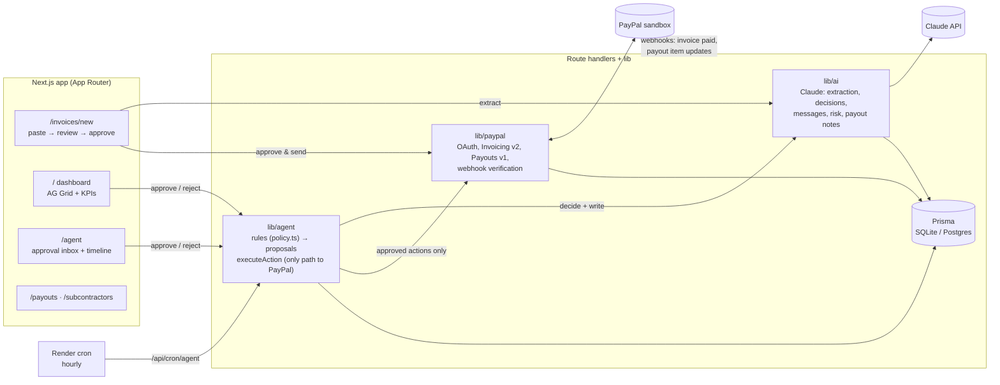

# Settle

**An AI collections agent for freelancers: it turns your agreements into PayPal invoices, chases late payments, and pays your subcontractors, but nothing goes out without your one-click approval.**

[](../../actions/workflows/ci.yml)
· **Live demo:** _https://settle-XXXX.onrender.com_ (PayPal sandbox)
· **Video:** _link_
· MIT licensed

---

## The problem

Freelancers and small agencies do the work, then spend unpaid hours being their own accounts-receivable
department: re-typing agreements into invoices, writing awkward "just following up…" emails, and
working out who gets what when a client finally pays. Late payments are routine, and some invoices
quietly get written off because chasing them feels worse than losing the money.

## What Settle does

1. **Paste an agreement or email thread.** Claude extracts the client, line items, due date, payment
   terms and any subcontractor splits, and flags the fields it isn't sure about.
2. **Approve the invoice.** Settle creates it with **PayPal Invoicing** and sends it.
3. **The agent watches unpaid invoices** and proposes the next step on an escalating ladder: a friendly
   nudge before the due date, a firm reminder when it's late, and a **payment plan** (partial payments
   enabled on the PayPal invoice) when it's 30+ days late or the client has signalled hardship.
4. **When the client pays** (in full or in part), the agent proposes **PayPal Payouts** to
   subcontractors for their proportional share.
5. **You approve, edit or reject every proposal** from an inbox. Nothing client-facing and nothing that
   moves money happens automatically.
6. **A receivables dashboard** (AG Grid) shows what's outstanding, aging, an AI risk score per invoice,
   and the agent's next proposed action with inline Approve / Reject.

## Architecture



**Lifecycle of a proposal:** rules pick the invoices that need attention → Claude picks the action and
writes the message → a `PROPOSED` `AgentAction` is saved with its reasoning → you approve (optionally
editing it) → `executeAction` calls PayPal → the result is recorded as `EXECUTED` or `FAILED`.

## PayPal APIs used

All calls go through [`src/lib/paypal`](src/lib/paypal) against `https://api-m.sandbox.paypal.com`.

| API | Endpoint | Used for | Code |
|---|---|---|---|
| OAuth 2.0 | `POST /v1/oauth2/token` | Access token, cached until expiry | [client.ts](src/lib/paypal/client.ts) |
| **Invoicing v2** | `POST /v2/invoicing/generate-next-invoice-number` | Invoice numbers | [invoicing.ts](src/lib/paypal/invoicing.ts) |
| | `POST /v2/invoicing/invoices` | Draft from the AI-extracted, user-approved data | 〃 |
| | `POST /v2/invoicing/invoices/{id}/send` | Send to the client, get the payer link | 〃 |
| | `POST /v2/invoicing/invoices/{id}/remind` | Approved reminders with the AI-written note | 〃 |
| | `PUT /v2/invoicing/invoices/{id}` | Payment plans: `allow_partial_payment` + `minimum_amount_due` | 〃 |
| | `GET /v2/invoicing/invoices/{id}` | Status sync (paid / partially paid / cancelled) and payments | 〃 |
| | `POST …/cancel`, `POST …/payments`, `GET /v2/invoicing/invoices` | Cancel, record off-PayPal payments, list | 〃 |
| **Payouts v1** | `POST /v1/payments/payouts` | One batch per approved split payout (`sender_batch_id` = action id for idempotency) | [payouts.ts](src/lib/paypal/payouts.ts) |
| | `GET /v1/payments/payouts/{batch_id}`, `GET …/payouts-item/{id}` | Item ids and statuses | 〃 |
| **Webhooks** | `POST /v1/notifications/verify-webhook-signature` | Verify every delivery (raw body, byte-for-byte) | [webhooks.ts](src/lib/paypal/webhooks.ts) |
| | Events: `INVOICING.INVOICE.PAID/UPDATED/CANCELLED/REFUNDED`, `PAYMENT.PAYOUTS-ITEM.*` | Idempotent on event id; update invoices and payouts | [handleWebhookEvent.ts](src/lib/invoices/handleWebhookEvent.ts) |

No public URL locally? **Sync with PayPal** (`POST /api/sync`) pulls the same state through the same code path.

## How AI is used

Claude is called with a single **strict tool** per task (`strict: true` JSON schema), and every result is
re-validated with zod. The model comes from `ANTHROPIC_MODEL`.

| Where | What Claude does | Code |
|---|---|---|
| **Extraction** | Agreement/email → client, line items, due date, terms, partial-payment terms, subcontractor splits, confidence, and a list of uncertain fields (highlighted in the review form) | [extractInvoice.ts](src/lib/ai/extractInvoice.ts) |
| **Agent decisions** | For each invoice the rules flag, chooses among only the actions the rules allow (or none) and explains why, using the client's payment history, previous reminders and notes | [collectionDecision.ts](src/lib/ai/collectionDecision.ts) |
| **Message writing** | Writes the reminder or payment-plan note in the right tone for the stage: friendly → firm → empathetic | 〃 |
| **Risk scoring** | 0–100 collection risk plus a one-line reason per open invoice. Cached by a fingerprint of the facts and re-scored only when they change, never on page load | [riskScore.ts](src/lib/ai/riskScore.ts), [risk.ts](src/lib/agent/risk.ts) |
| **Payout explanations** | Plain-English explanation of who gets what (including proportional shares on partial payments) | [payoutExplanation.ts](src/lib/ai/payoutExplanation.ts) |

The split of responsibilities is deliberate. **Deterministic rules decide _whether_ to act and what's
allowed** (testable, predictable), and **Claude decides _what_ to say and which allowed step fits**
(judgment and writing). Money math, such as payout shares and payment-plan bounds, is never left to the
model.

## Human-in-the-loop safety

- **Every client-facing or money-moving action is a `PROPOSED` `AgentAction` first**, with its exact
  message and reasoning. Only [`executeAction`](src/lib/agent/executeAction.ts) can turn it into a PayPal
  call, and only after a human approves it.
- **Approve, Edit & approve, or Reject.** Edits are recorded; rejections put that invoice on a cool-down.
- **No double execution:** approval atomically claims `PROPOSED → APPROVED`, so a double click runs once.
- **No duplicate proposals:** a unique `pendingKey` allows only one pending proposal per invoice, even if
  two agent runs overlap.
- **No overpaying:** payouts are re-checked against what's currently owed right before execution;
  `sender_batch_id` makes the PayPal call idempotent; shares are floored to the cent.
- **The agent can't invent options:** Claude only sees the action types the rules allow for that invoice.
- **Full audit trail:** every run logs what it looked at and decided (`AgentRunLog`), shown on `/agent`.
- **Verified webhooks:** unverifiable deliveries are rejected and not stored.

## Run it locally (5 commands)

Requires Node 22+.

```bash
git clone https://github.com/OWNER/settle.git && cd settle
npm install
cp .env.example .env      # then fill in the PayPal sandbox + Anthropic keys (see below)
npm run setup             # create the SQLite DB and load demo data
npm run dev               # http://localhost:3000
```

Other useful commands: `npm test` (Vitest, all external calls mocked), `npm run lint`,
`npm run typecheck`, `npm run smoke:invoice` (send a real sandbox invoice from the CLI).

### Keys you need

| Variable | Where to get it |
|---|---|
| `PAYPAL_CLIENT_ID`, `PAYPAL_CLIENT_SECRET` | [developer.paypal.com](https://developer.paypal.com/dashboard/applications/sandbox) → Apps & Credentials → **Sandbox** → your app |
| `ANTHROPIC_API_KEY` | [console.anthropic.com](https://console.anthropic.com/) |
| `PAYPAL_WEBHOOK_ID` | Optional locally (use **Sync with PayPal**). See [docs/webhooks.md](docs/webhooks.md) |
| `CRON_SECRET`, `DEMO_MODE` | Optional; see `.env.example` |

## Testing with PayPal sandbox accounts

PayPal gives every developer account two test users, under **Testing Tools → Sandbox Accounts** in
the [developer dashboard](https://developer.paypal.com/dashboard/accounts):

- a **Business** account. Your REST app belongs to it, so it's the invoicer and the payout sender.
- a **Personal** account (…`@personal.example.com`). Use it as the **client who pays**.

To pay an invoice as the client:

1. In Settle, create an invoice and set the client email to the **personal** account's email.
2. On the success screen (or in the invoice's side panel), click **Open PayPal invoice**.
3. Click **Pay** and log in with the personal account. To get its password, go to Sandbox Accounts →
   ⋯ → **View/Edit account**. Pay all of it, or part of it if partial payments are on.
4. Back in Settle, click **Sync with PayPal** (or wait for the webhook). The invoice turns *Paid* or
   *Partially paid*, and if it has subcontractor splits, a payout proposal appears in **Agent**.

To see payouts **succeed** rather than stay *Unclaimed*, give subcontractors the email of another
sandbox personal account (create one under Sandbox Accounts → **Create account**). Make sure **Payouts**
is enabled in your app's feature settings.

> The seeded sample invoices are marked **DEMO** and never touch PayPal. Approving their proposals is
> simulated and labelled as such.

## Project layout

```
src/app/            pages + API routes (/api/invoices, /api/agent, /api/webhooks/paypal, /api/sync, /api/cron/agent, /api/health)
src/lib/paypal/     the only code that talks to PayPal
src/lib/ai/         Claude prompts + strict tool schemas
src/lib/agent/      rules, proposals, execution, payout math
src/lib/invoices/   send flow, PayPal sync, webhook handling, dashboard data
prisma/             schema + migrations (SQLite) · postgres/ (Render)
tests/              Vitest: split math, agent rules, webhook idempotency, extraction
docs/               webhooks.md, deploy.md (Render)
```

## Deploying

`render.yaml` defines the web service, Postgres and an hourly agent cron; migrations run on every deploy.
Step-by-step instructions and the env var list are in [docs/deploy.md](docs/deploy.md).

## Built with

Next.js 15 · TypeScript · Tailwind CSS 4 · Prisma · PayPal REST APIs (Invoicing v2, Payouts v1, Webhooks) ·
Anthropic Claude (`@anthropic-ai/sdk`) · AG Grid Community · zod · Vitest · Render

## License

[MIT](LICENSE)
